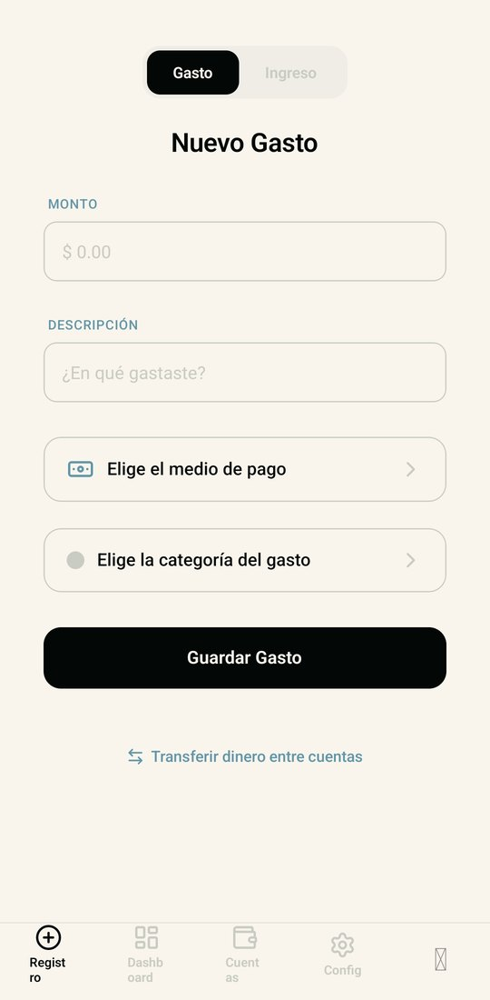
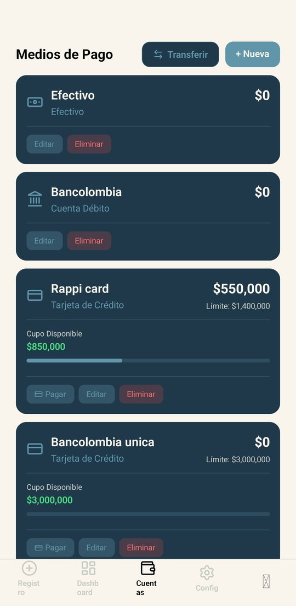
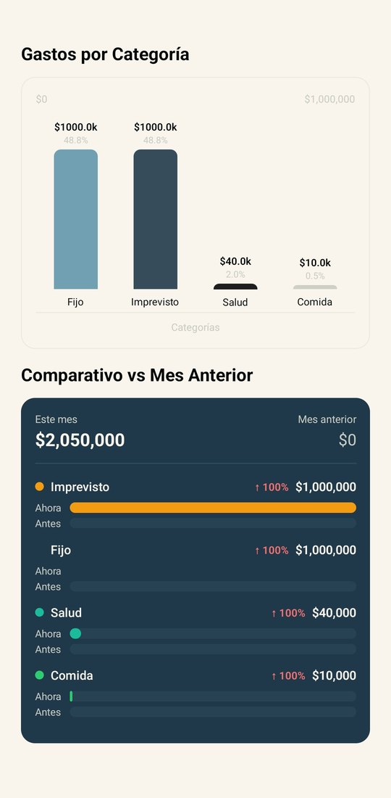
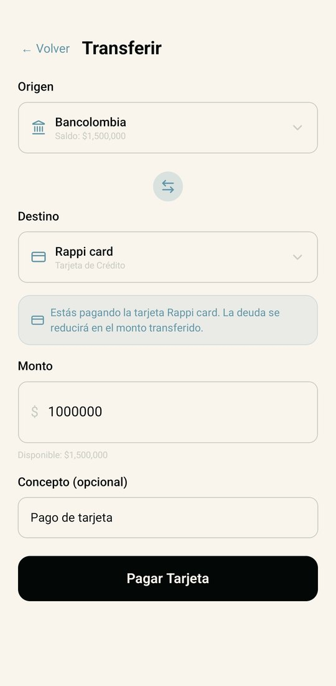
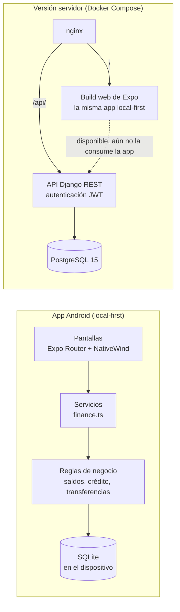

<p align="center"></p>

<p align="center"><a href="README.md">English</a> · <b>Español</b></p>

<p align="center">
  <b>Una app de finanzas personales pensada para la fricción cero: registra un gasto en segundos, reúne efectivo, débito y tarjetas de crédito en un solo lugar y descubre en qué se va realmente tu dinero.</b>
</p>

<p align="center">
  
  
  
  
  <br>
  
  
  
  
  
</p>

<p align="center">
  
  
  
  
</p>
<p align="center"><sub>Registro rápido · Medios de pago · Dashboard de gastos · Pago de tarjeta</sub></p>

---

## Dos versiones, un mismo producto

| Versión | Dónde corre | Stack | Ideal para |
| --- | --- | --- | --- |
| **App Android (local-first)** | En el propio celular | Expo + React Native + TypeScript + **SQLite** | Uso sin conexión, datos 100 % en el dispositivo |
| **Versión servidor** | Cualquier host Linux con Docker | API de **Django REST Framework** (JWT, PostgreSQL) + la app de Expo exportada como build web, servida por nginx | Backend con API REST y PostgreSQL, acceso desde el navegador |

El código actual de la app es local-first: cada pantalla usa una capa de servicios en TypeScript que guarda los datos en SQLite dentro del teléfono, así que el APK funciona sin backend y sin internet. La versión servidor es un stack de Docker Compose: nginx sirve esa misma app como build web (sigue siendo local-first y corre en el navegador) y redirige `/api/` a una API de Django REST con autenticación JWT y PostgreSQL. La API modela el mismo dominio (cuentas, categorías, transacciones y metas de ahorro) y funciona por sí sola, pero todavía no está conectada a las pantallas de la app.

## Funcionalidades

- **Registro sin fricción.** Una sola pantalla para anotar un gasto o un ingreso: monto, descripción, medio de pago, categoría y guardar.
- **Todos tus medios de pago.** Efectivo, cuentas de débito y tarjetas de crédito, cada uno con su saldo; las tarjetas llevan límite, deuda y cupo disponible.
- **Saldos realistas.** Los gastos reducen el saldo de efectivo y débito y aumentan la deuda de la tarjeta; eliminar una transacción revierte su efecto.
- **Transferencias y pago de tarjetas.** Mueve dinero entre cuentas o abona a una tarjeta de crédito y ve cómo se repone el cupo.
- **Modelo de datos listo para cuotas.** Las transacciones guardan el número de cuotas y calculan el valor por cuota y las cuotas restantes; elegir las cuotas desde la interfaz aún no está construido.
- **Dashboard de gastos.** Ingresos contra gastos, gasto por categoría y comparativo por categoría contra el mes anterior.
- **Metas de ahorro.** Crea metas, agrega o retira fondos y sigue su avance con barras de progreso en el dashboard.
- **Onboarding guiado.** Un primer uso pregunta por pregunta que configura tu nombre, saldo, cuentas de débito y tarjetas de crédito.
- **Categorías predefinidas.** Un conjunto listo para usar (fijos, comida, transporte, salud, entretenimiento, compras, gastos hormiga, imprevistos) que puedes editar o ampliar.

## Stack tecnológico

| Capa | App Android (local-first) | Versión servidor |
| --- | --- | --- |
| Interfaz | Expo Router, NativeWind (Tailwind), Reanimated, íconos lucide | La misma app de Expo exportada como build web |
| Lógica | Servicios en TypeScript + reglas de negocio (`src/db/businessLogic.ts`) | ViewSets y serializers de Django REST Framework |
| Datos | `expo-sqlite` en el dispositivo | PostgreSQL 15 |
| Autenticación | Perfil local, sin login remoto | SimpleJWT en la API (tokens de acceso y renovación), aún no usado por la app |
| Entrega | EAS Build (APK) | Docker Compose, nginx como proxy inverso |

## Arquitectura



## Cómo empezar

### App Android (desarrollo local)

Requisitos: Node.js 20.19+ (LTS) y un dispositivo Android con Expo Go o un emulador.

```bash
git clone https://github.com/waldooCreator/Conciencia_financiera.git
cd Conciencia_financiera/frontend
npm install
npm run android        # expo start --android
```

Para generar un APK instalable con EAS Build (requiere una cuenta de Expo):

```bash
npx eas-cli build --platform android --profile preview
```

### Versión servidor (Docker)

Requisitos: Docker y Docker Compose.

```bash
git clone https://github.com/waldooCreator/Conciencia_financiera.git
cd Conciencia_financiera
cp .env.example .env   # completa con tus propios valores
make up-build          # docker-compose up -d --build
```

El stack levanta PostgreSQL, la API de Django, el frontend con nginx y un contenedor de Redis. El backend espera a PostgreSQL y aplica las migraciones al arrancar. Luego abre `http://localhost:3020` para el build web; la API responde bajo `/api/` (por ejemplo `/api/health/`). Ejecuta `make help` para ver todos los atajos (logs, shell, tests, superusuario, limpieza).

> El contenedor del frontend ocupa los puertos **80** y **3020**; libera el puerto 80 o edita `docker-compose.yml` antes de ejecutar `make up-build`.

Para un despliegue directo en Linux con Gunicorn, nginx y systemd, consulta [`docs/deploy-linux.md`](docs/deploy-linux.md).

<details>
<summary><b>Resumen de la API REST (versión servidor)</b></summary>

| Recurso | Endpoints | Acciones adicionales |
| --- | --- | --- |
| Autenticación | `POST /api/users/register/` · `POST /api/token/` · `POST /api/token/refresh/` | `GET/PATCH /api/users/profile/` |
| Cuentas | `/api/wallets/` · `/api/wallets/{id}/` | — |
| Categorías | `/api/categories/` · `/api/categories/{id}/` | `POST seed_defaults/` |
| Transacciones | `/api/transactions/` · `/api/transactions/{id}/` | `GET summary/` · `GET comparison/` |
| Metas | `/api/goals/` · `/api/goals/{id}/` | `POST {id}/add_funds/` · `POST {id}/withdraw_funds/` |
| Salud | `GET /api/health/` | — |

Las rutas protegidas requieren `Authorization: Bearer <access_token>`.

</details>

## Estructura del proyecto

```
Conciencia_financiera/
├── frontend/              # App Expo + React Native (APK y PWA)
│   ├── app/               # Pantallas (expo-router): tabs, onboarding, metas, transferencia...
│   ├── src/
│   │   ├── db/            # Cliente SQLite, esquema y reglas de negocio
│   │   ├── services/      # Servicios de finanzas, autenticación y estado de la app
│   │   └── components/    # UI reutilizable: gráficos, inputs, tarjetas, toasts
│   ├── public/            # Capturas de pantalla
│   ├── Dockerfile         # Export web de Expo servido por nginx
│   └── nginx.conf         # PWA estática + proxy inverso /api
├── backend/               # API Django REST Framework
│   ├── apps/              # users, wallets, categories, transactions, goals, health
│   └── config/            # Configuración y rutas
├── infrastructure/db/     # Script de inicialización de PostgreSQL
├── docs/                  # Guía de despliegue en Linux y recursos del README
├── .specs/ .design/ .tasks/   # Spec-Driven Development: specs, diseño y plan de tareas
├── docker-compose.yml
└── Makefile
```

## Cómo se construyó

El proyecto siguió **Spec-Driven Development**: requisitos en [`.specs/specs.md`](.specs/specs.md), diseño técnico y de UI/UX (incluida la paleta de colores) en [`.design/design.md`](.design/design.md) y un plan de tareas por fases en [`.tasks/tasks.md`](.tasks/tasks.md), implementado mediante un historial de commits convencionales.

| Color | Hex | Uso |
| --- | --- | --- |
| Noir | `#030706` | Texto principal, superficies oscuras |
| Denim | `#20394a` | Tarjetas y contenedores |
| Bone | `#f9f5ed` | Fondo principal |
| Steel | `#6196aa` | Acentos y botones secundarios |
| Concrete | `#c9ccc3` | Bordes y placeholders |

## Autor

**Walter Velasco** · [@waldooCreator](https://github.com/waldooCreator)

Desarrollado como proyecto universitario de desarrollo móvil junto con Juan Sebastián Gallego Carrillo.
