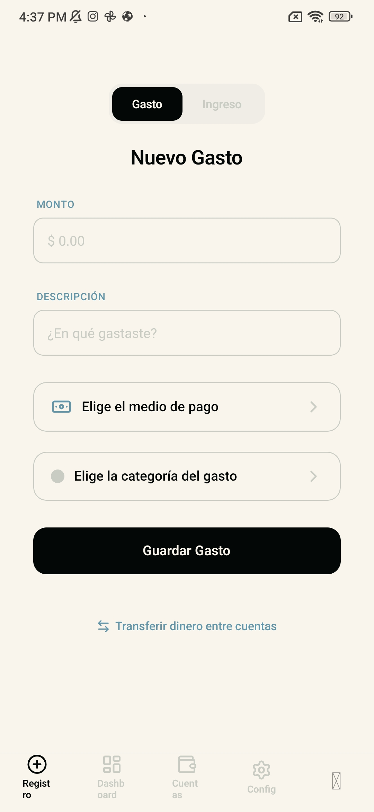
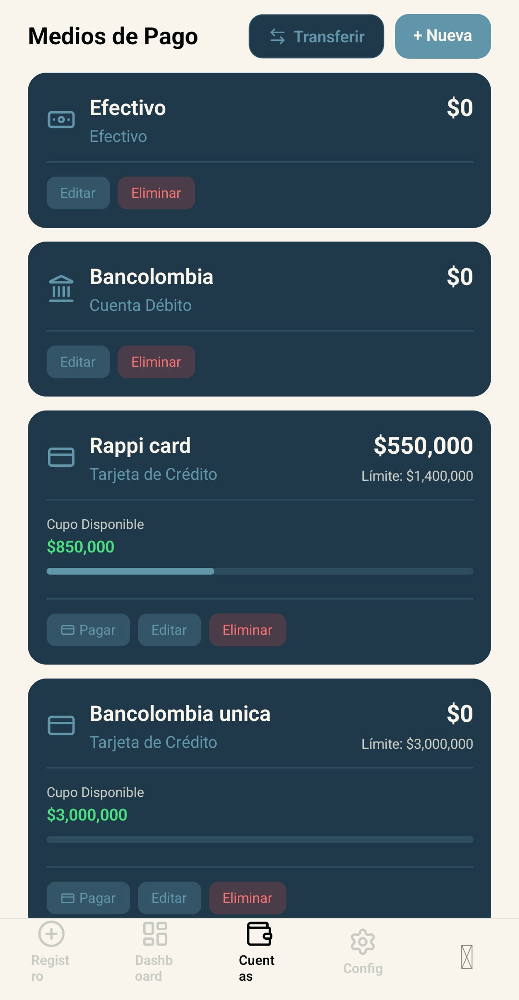
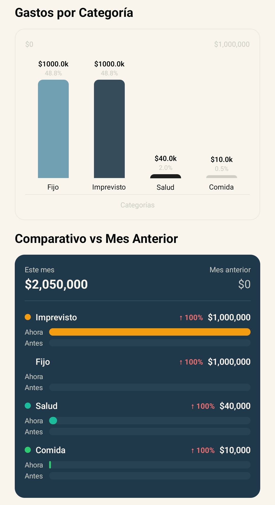
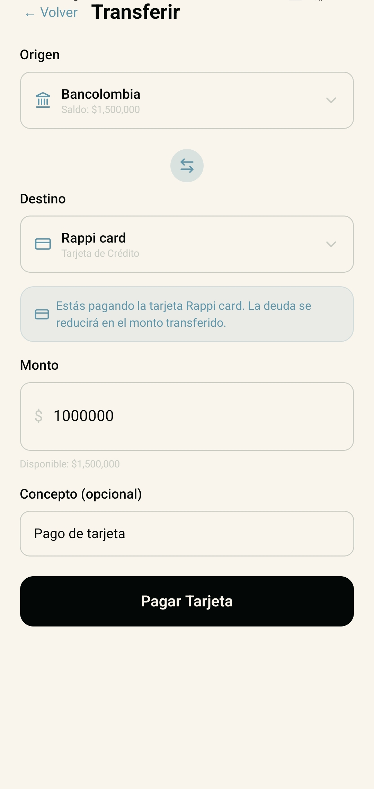
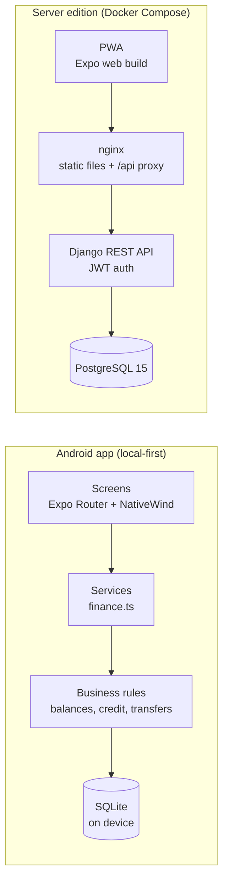

<p align="center"></p>

<p align="center"><b>English</b> · <a href="README.es.md">Español</a></p>

<p align="center">
  <b>A personal finance app built for zero friction: log an expense in seconds, keep cash, debit and credit cards in one place, and see where your money actually goes.</b>
</p>

<p align="center">
  
  
  
  
  <br>
  
  
  
  
  
</p>

<p align="center">
  
  
  
  
</p>
<p align="center"><sub>Quick entry · Payment methods · Spending dashboard · Credit card payment</sub></p>

---

## Two editions, one product

| Edition | Runs on | Stack | Best for |
| --- | --- | --- | --- |
| **Android app (local-first)** | The phone itself | Expo + React Native + TypeScript + **SQLite** | Offline use, data stays 100% on the device |
| **Server edition** | Any Linux host with Docker | **Django REST Framework** + PostgreSQL + nginx, PWA frontend | Web access, centralized data, JWT accounts |

The current app code is local-first: every screen talks to a TypeScript service layer that stores data in SQLite on the device, so the APK works with no backend and no internet. The Django REST API models the same domain (wallets, categories, transactions, savings goals) for the server edition, served behind nginx with JWT authentication.

## Features

- **Zero-friction entry.** One screen to log an expense or income: amount, description, payment method, category, save.
- **All your payment methods.** Cash, debit accounts and credit cards, each with its own balance; credit cards track limit, debt and available credit.
- **Realistic balance rules.** Expenses lower cash and debit balances and raise credit card debt; deleting a transaction reverses its effect.
- **Transfers and card payments.** Move money between accounts or pay off a credit card and watch the available credit come back.
- **Installments.** Credit card purchases can be split into installments with the per-installment amount and remaining count computed for you.
- **Spending dashboard.** Income vs. expenses, spending by category and a month-over-month comparison per category.
- **Savings goals.** Create goals, add or withdraw funds and follow progress bars right on the dashboard.
- **Guided onboarding.** A question-by-question first run that sets up your name, balance, debit accounts and credit cards.
- **Default categories.** A ready-made set (fixed costs, food, transport, health, "ant" expenses, unexpected) that you can edit or extend.

## Tech stack

| Layer | Android app (local-first) | Server edition |
| --- | --- | --- |
| UI | Expo Router, NativeWind (Tailwind), Reanimated, lucide icons | Same Expo app exported as a PWA |
| Logic | TypeScript services + business rules (`src/db/businessLogic.ts`) | Django REST Framework ViewSets and serializers |
| Data | `expo-sqlite` on the device | PostgreSQL 15 |
| Auth | Local profile, no remote login | SimpleJWT (access + refresh tokens) |
| Delivery | EAS Build (APK) | Docker Compose, nginx reverse proxy |

## Architecture



## Getting started

### Android app (local development)

Requirements: Node.js 18+, and an Android device with Expo Go or an emulator.

```bash
git clone https://github.com/waldooCreator/Conciencia_financiera.git
cd Conciencia_financiera/frontend
npm install
npm run android        # expo start --android
```

To build an installable APK with EAS Build (requires an Expo account):

```bash
npx eas-cli build --platform android --profile preview
```

### Server edition (Docker)

Requirements: Docker and Docker Compose.

```bash
git clone https://github.com/waldooCreator/Conciencia_financiera.git
cd Conciencia_financiera
cp .env.example .env   # fill in your own values
make up-build          # docker-compose up -d --build
```

The backend waits for PostgreSQL and applies migrations on startup. Then open `http://localhost:3020` for the PWA; the API answers under `/api/` (for example `/api/health/`). Run `make help` to list every shortcut (logs, shell, tests, superuser, clean).

For a bare-metal Linux deployment with Gunicorn, nginx and systemd, see [`docs/deploy-linux.md`](docs/deploy-linux.md).

<details>
<summary><b>REST API overview (server edition)</b></summary>

| Resource | Endpoints | Extra actions |
| --- | --- | --- |
| Auth | `POST /api/users/register/` · `POST /api/token/` · `POST /api/token/refresh/` | `GET/PATCH /api/users/profile/` |
| Wallets | `/api/wallets/` · `/api/wallets/{id}/` | — |
| Categories | `/api/categories/` · `/api/categories/{id}/` | `POST seed_defaults/` |
| Transactions | `/api/transactions/` · `/api/transactions/{id}/` | `GET summary/` · `GET comparison/` |
| Goals | `/api/goals/` · `/api/goals/{id}/` | `POST {id}/add_funds/` · `POST {id}/withdraw_funds/` |
| Health | `GET /api/health/` | — |

Protected routes expect `Authorization: Bearer <access_token>`.

</details>

## Project structure

```
Conciencia_financiera/
├── frontend/              # Expo + React Native app (APK and PWA)
│   ├── app/               # Screens (expo-router): tabs, onboarding, goals, transfer...
│   ├── src/
│   │   ├── db/            # SQLite client, schema and business rules
│   │   ├── services/      # Finance, auth and app-state services
│   │   └── components/    # Reusable UI: charts, inputs, cards, toasts
│   ├── public/            # Screenshots
│   ├── Dockerfile         # Expo web export served by nginx
│   └── nginx.conf         # Static PWA + /api reverse proxy
├── backend/               # Django REST Framework API
│   ├── apps/              # users, wallets, categories, transactions, goals, health
│   └── config/            # Settings and URL routing
├── infrastructure/db/     # PostgreSQL init script
├── docs/                  # Linux deployment guide
├── .specs/ .design/ .tasks/   # Spec-Driven Development: specs, design, task plan
├── docker-compose.yml
└── Makefile
```

## How it was built

The project followed **Spec-Driven Development**: requirements in [`.specs/specs.md`](.specs/specs.md), technical and UI/UX design (including the color palette) in [`.design/design.md`](.design/design.md), and a phased task plan in [`.tasks/tasks.md`](.tasks/tasks.md), implemented through a history of conventional commits.

| Color | Hex | Role |
| --- | --- | --- |
| Noir | `#030706` | Primary text, dark surfaces |
| Denim | `#20394a` | Cards and containers |
| Bone | `#f9f5ed` | Main background |
| Steel | `#6196aa` | Accents and secondary buttons |
| Concrete | `#c9ccc3` | Borders and placeholders |

## Author

**Walter Velasco** · [@waldooCreator](https://github.com/waldooCreator)

Built as a university mobile development project together with Juan Sebastián Gallego Carrillo.
